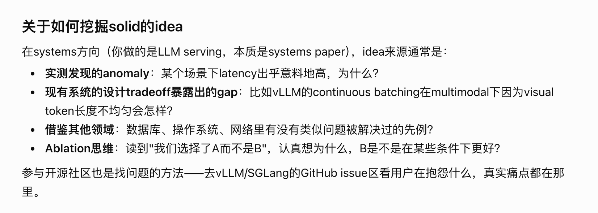
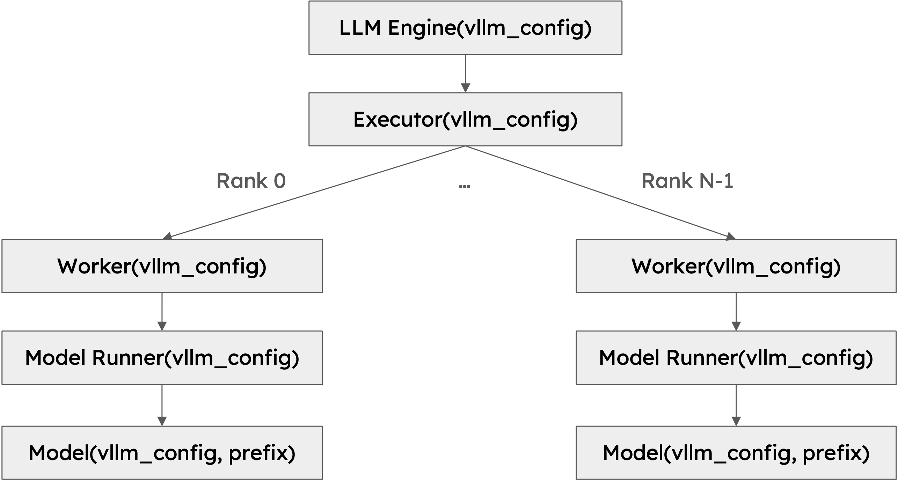

# vLLM 架构与多模态实验问题

原始学习记录。架构与源码路径会随版本变化，实验前记录实际 commit。





vllm作为推理引擎，可以**组织大模型当中到来的请求，从而高效地执行**
vllm v1的基础架构


llm engine包含的部件：




hierarchy层次
```
LLMEngine
    └── Executor
            └── Worker
                    └── ModelRunner
                            └── Model
- Engine 持有或调用 Executor；
- Executor 控制 Worker；
- Worker 使用 ModelRunner；
- ModelRunner 持有模型实例。
```

多模态推理系统
首先要确定多模态推理的问题所在
**图片分辨率和视觉 token 数量增加时，新增成本到底出现在哪里？**
- 视觉编码时间是否增加？
- TTFT 增加多少？
- GPU 显存增加多少？
- KV Cache 占用是否随视觉 token 数增长？
- 多请求并发时，视觉较重的请求是否影响文本请求的 ITL？
- Scheduler 是否会把长视觉 Prefill 切成多个 chunk？
- 高负载时，减少视觉 token 是否能改善质量—延迟权衡？

| 阶段           | 我们将验证的问题                       |
| ------------ | ------------------------------ |
| 图片处理         | 高分辨率的时间花在 CPU 处理、搬运，还是其他地方？    |
| 视觉编码         | 降低分辨率与编码后剪 token，各省掉什么？        |
| 语言模型 prefill | 视觉位置增加后，时延与 KV 占用怎样变化？         |
| Decode       | 长视觉上下文给后续每个输出 token 增加多少成本？    |
| 缓存           | 重复图片比例如何影响收益？                  |
| 调度与负载        | 哪种负载真正改变候选策略的优劣？               |
| 动态策略         | 是否胜过最好固定策略及仅依赖输入的策略，且收益覆盖决策开销？ |
