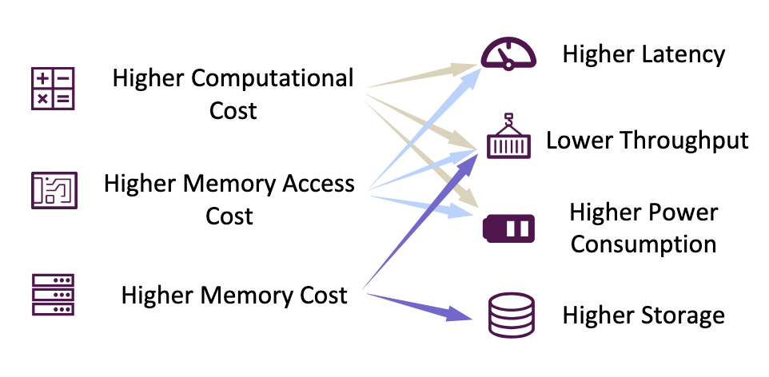
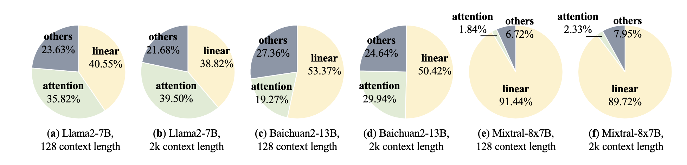
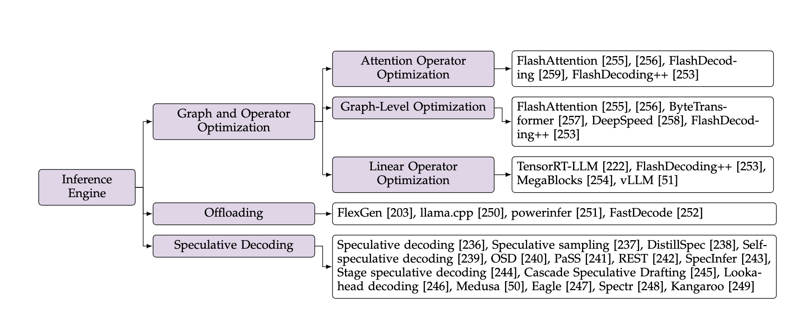
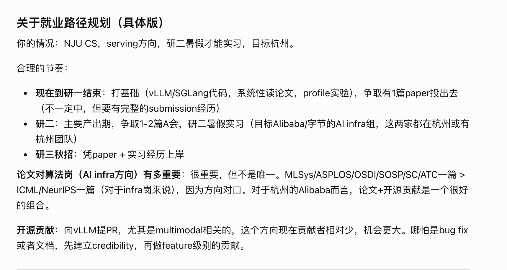
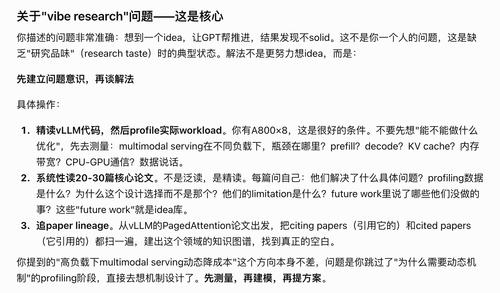
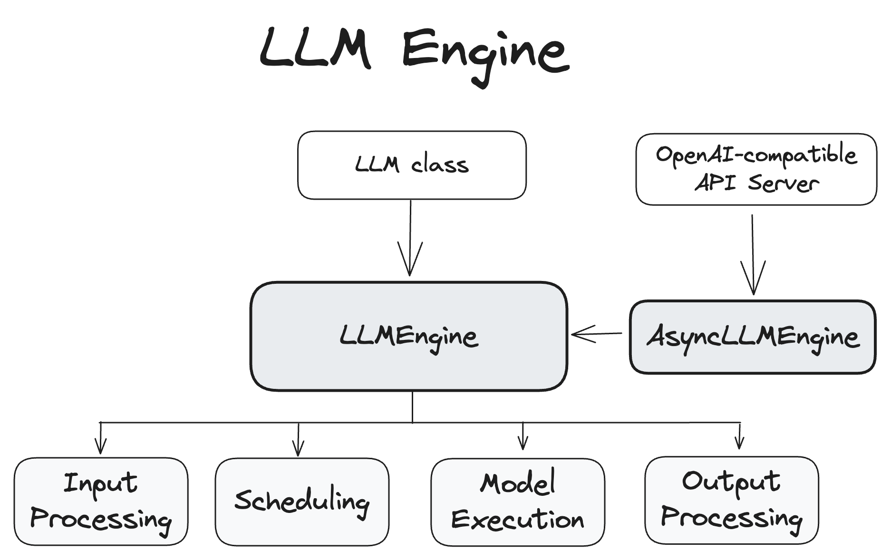
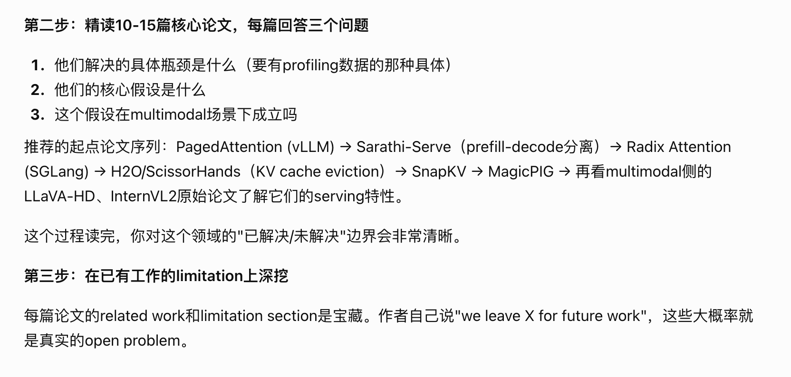
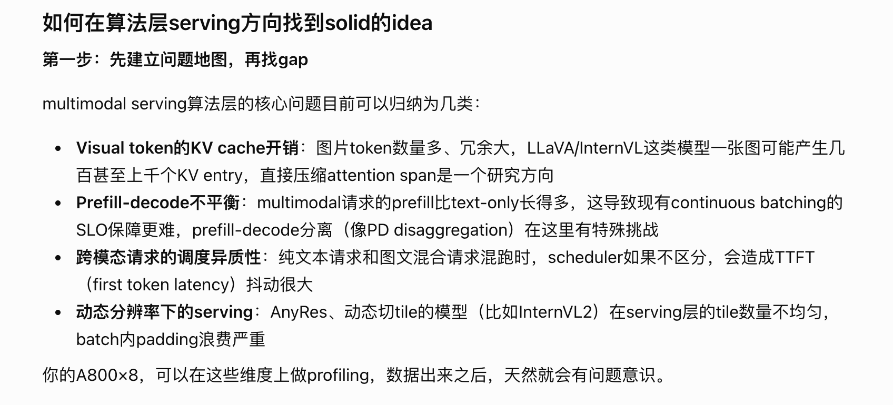
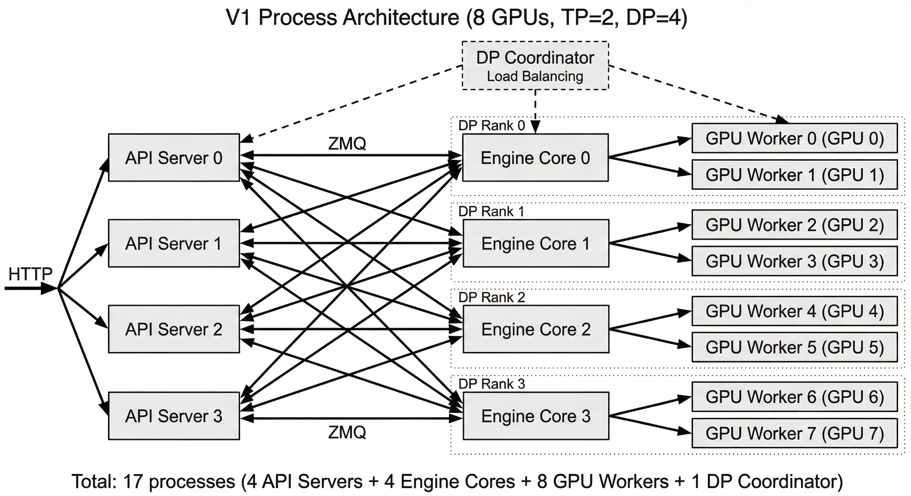

# 原始笔记配图

这些图片来自原有学习笔记，保留用于对应原文。截图中第三方图表的权利属于原作者；具体出处应在后续精读中补充。下表同时保留尚未被正文引用的图片。

## inference-survey-20261013152050

原文件：`Pasted image 20261013152050.png`

## inference-survey-20261013170333

原文件：`Pasted image 20261013170333.png`

## inference-survey-20261013170339

原文件：`Pasted image 20261013170339.png`

## inference-survey-20261013170658

原文件：`Pasted image 20261013170658.png`

## serving-system-20261013135357

原文件：`图片/Pasted image 20261013135357.png`

## vllm-20261011134747

原文件：`图片/Pasted image 20261011134747.png`

## serving-system-20261013135621

原文件：`图片/Pasted image 20261013135621.png`

## serving-system-20261013135309

原文件：`图片/Pasted image 20261013135309.png`

## vllm-20261011143230

原文件：`图片/Pasted image 20261011143230.png`

## serving-system-20261013135910

原文件：`图片/Pasted image 20261013135910.png`

## serving-system-20261013135854

原文件：`图片/Pasted image 20261013135854.png`

## vllm-20261011135147

原文件：`图片/Pasted image 20261011135147.png`

## vllm-20261011143305

原文件：`图片/Pasted image 20261011143305.png`

